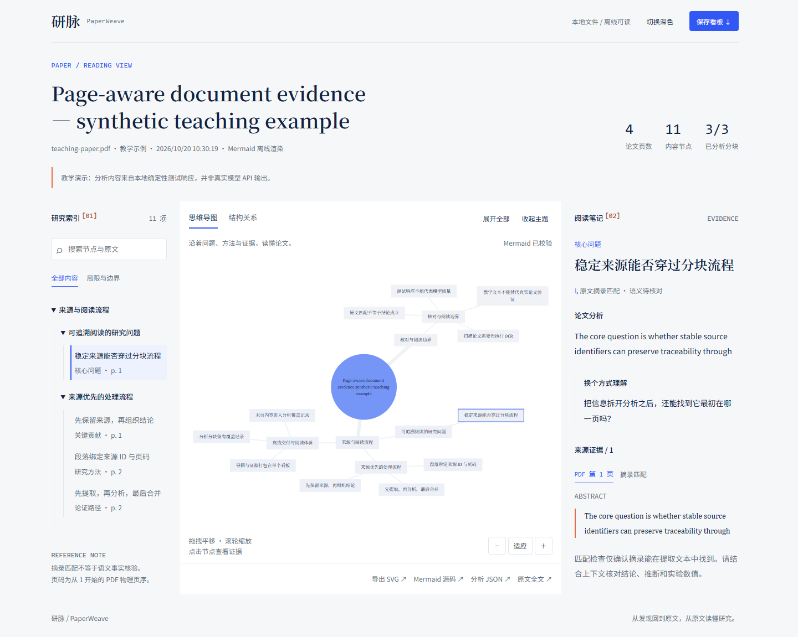
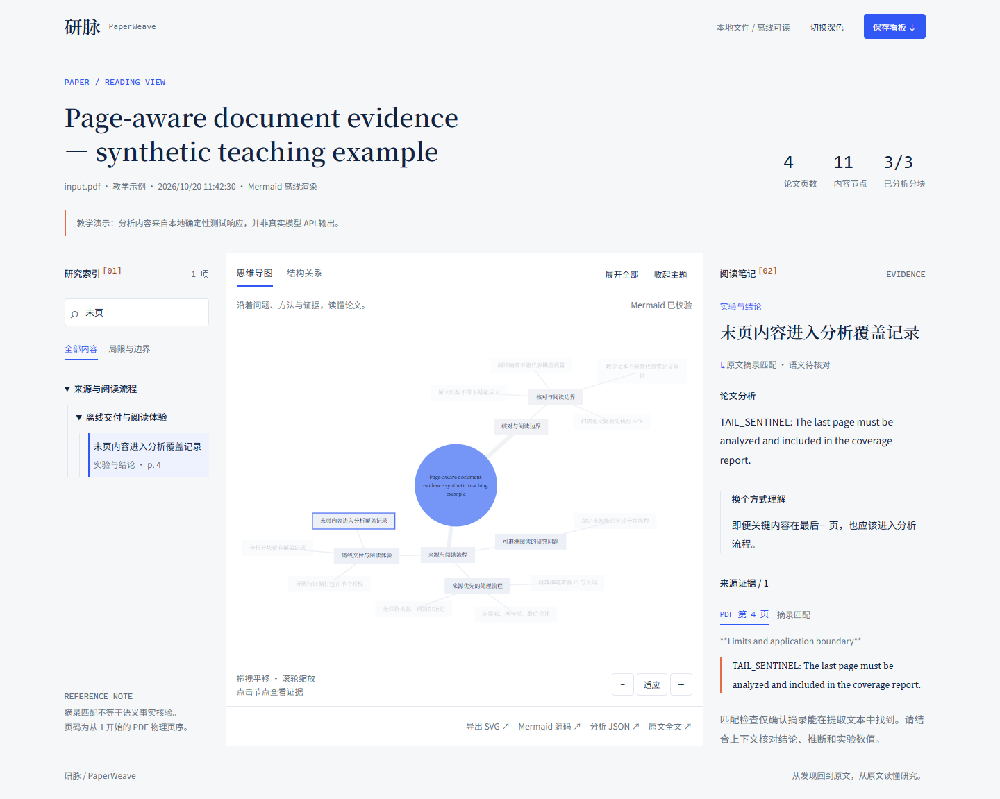
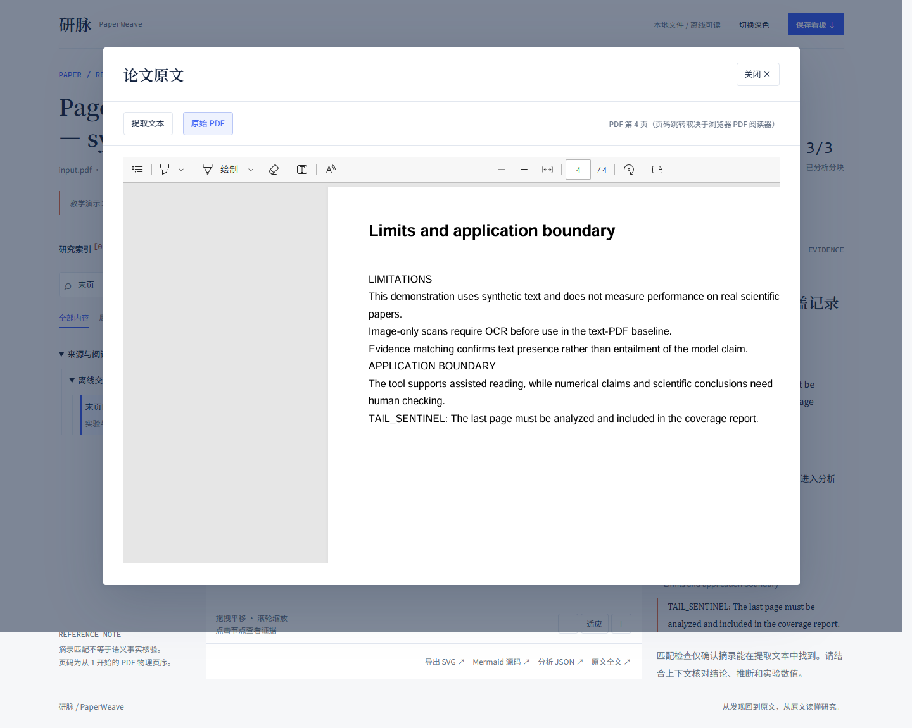
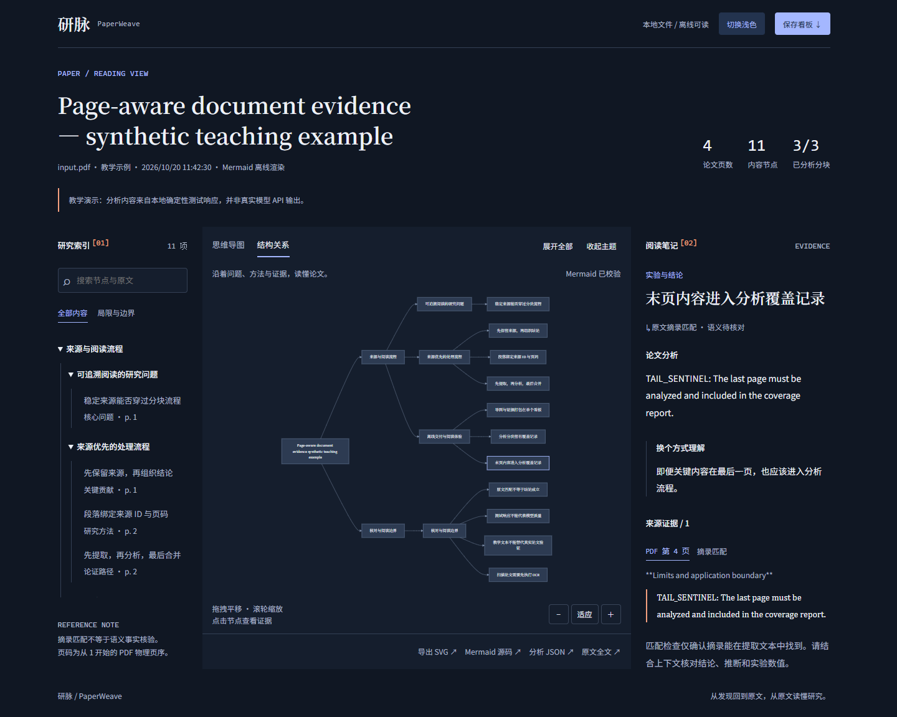
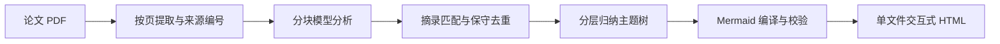

# 研脉 PaperWeave

把学术论文 PDF 转成带原文证据的 Mermaid 导图和可离线打开的交互式 HTML 阅读看板。

PaperWeave 按页提取论文，使用可配置的模型接口逐块分析，再把研究问题、方法、贡献、实验结论与局限组织成主题树。每个内容节点保留来源编号、PDF 物理页码和原文摘录，方便从分析结果回到原文。



## 目录

- [快速体验](#快速体验)
- [环境与安装](#环境与安装)
- [配置模型接口](#配置模型接口)
- [通过网页使用](#通过网页使用)
- [通过命令行使用](#通过命令行使用)
- [输出文件](#输出文件)
- [工作原理](#工作原理)
- [开发与测试](#开发与测试)
- [示例与已知限制](#示例与已知限制)
- [常见问题](#常见问题)
- [开源与复用](#开源与复用)

## 功能

- **按页解析 PDF**：提取 Markdown 文本，记录章节、物理页码和稳定来源 ID。
- **分块分析长文**：逐块处理全部已提取来源，保存每块的处理记录，再分层归纳主题。
- **证据关联**：节点附原文摘录与页码，标明摘录匹配、分析者推断或未匹配状态。
- **两种 Mermaid 视图**：思维导图与层级结构关系图，支持平移、缩放和主题收起/展开。
- **交互阅读**：节点搜索、局限与边界筛选、原文窗口、可选内嵌 PDF、深浅主题和键盘操作。
- **独立交付**：单文件 HTML 内嵌脚本、样式、分析数据和可选 PDF，保存后可以离线阅读。
- **多格式导出**：HTML、SVG、Mermaid 源码和分析 JSON。
- **接口配置**：通过 Base URL、API Key 和模型 ID 连接 Chat Completions 兼容接口。

## 快速体验

在项目目录依次打开 `outputs` → `teaching-demo`，双击 `dashboard.html`，选择 Edge 或 Chrome 打开。查看已有看板不需要启动 Python 服务或连接网络。

自带示例使用 `examples/teaching-paper.pdf`，是一份包含末页限制条件的四页合成文档，不是已发表论文。看板来自确定性测试响应，页面明确标注其来源，用于体验交互，不代表真实模型的论文分析效果。

安装项目后，也可以重新生成示例：

```powershell
.\.venv\Scripts\python.exe examples/build_demo.py
```

要分析自己的论文，请完成下面的模型配置并使用上传页面或命令行。

## 环境与安装

当前在 Windows、Python 3.12、Microsoft Edge 上运行并测试。项目声明支持 Python 3.10 及以上，建议使用已经测试的 Python 3.12；其他系统尚未在本机验证。

先解压或克隆项目，进入同时包含 `README.md`、`pyproject.toml`、`requirements.txt` 和 `src/` 的根目录。在资源管理器地址栏输入 `powershell` 并按 Enter，即可在这个目录打开终端。

确认 Python 可用：

```powershell
py -3.12 --version
```

输出应为 `Python 3.12.x`。如果尚未安装，可按 [Python 官方 Windows 安装说明](https://docs.python.org/3.12/using/windows.html) 准备 Python 3.12。若系统使用 `python3.12` 而非 `py`，可把下面创建环境的第一行替换为 `python3.12 -m venv .venv`。

在项目根目录逐行执行：

```powershell
py -3.12 -m venv .venv
.\.venv\Scripts\python.exe -m pip install -r requirements.txt
.\.venv\Scripts\python.exe -m pip install -e . --no-deps
```

程序通过 Playwright 调用 Chromium 内核校验、渲染 Mermaid，会依次尝试本机 Edge、Chrome 和已安装的 Playwright Chromium。找不到可用浏览器时执行：

```powershell
.\.venv\Scripts\python.exe -m playwright install chromium
```

正常运行不需要 Node。仓库已包含构建好的 `src/paperweave/static/mermaid.bundle.js`；只有修改浏览器依赖后才需要使用 Node 20+ 重新构建：

```powershell
npm ci
npm run build
```

## 配置模型接口

### 1. 创建配置文件

```powershell
if (-not (Test-Path -LiteralPath ".env")) {
    Copy-Item -LiteralPath ".env.example" -Destination ".env"
}
notepad .env
```

在 `.env` 中填写三项真实参数，替换模板中的占位内容：

```dotenv
LLM_BASE_URL=https://your-provider.example/v1
LLM_API_KEY=填写自己的API密钥
LLM_MODEL=填写服务商提供的准确模型ID
```

在编辑器按 Ctrl+S 保存，确认文件名是 `.env`，不是 `.env.txt`。上述创建命令保留已有配置文件。

- Base URL 可以是 `https://host/v1`，程序会追加 `/chat/completions`；也支持完整的 Chat Completions 接口地址。
- 模型 ID 以服务商文档和账号权限为准。程序不固定模型或供应商，也不发送特定模型才支持的温度或 JSON 模式参数。
- 系统环境变量优先于 `.env`。修改配置后应退出旧服务并重新启动，再刷新页面。
- 原文片段会发送到配置的模型服务。生成时必须能连接该服务；使用远端服务时需要网络，生成后的 HTML 可以离线打开。
- `.env` 只保存在本机。密钥不写入源码、分析结果和导出的 HTML，也不应提交到 Git。

### 2. 可选参数

| 参数 | 默认值 | 作用 |
|---|---|---|
| `CHUNK_CHARS` | `10000` | 分析块的字符预算，包含序列化来源信息；范围 2000–24000 |
| `LLM_MAX_TOKENS` | `5000` | 单次请求的输出 token 上限；范围 512–32000 |
| `LLM_TIMEOUT` | `180` | HTTP 请求超时设置，单位为秒，必须大于 0 |
| `LLM_RETRIES` | `2` | 连接或部分服务错误的重试次数；范围 0–5 |
| `EMBED_PDF` | `1` | 是否把原 PDF 内嵌到看板和分析 JSON；设为 `0` 可减小文件 |

### 3. 检查本地配置

```powershell
.\.venv\Scripts\python.exe -m paperweave doctor
```

该命令检查配置完整性、浏览器和 Mermaid 资源，不调用真实 API。因此检查通过不等于密钥和模型权限已经验证。

## 通过网页使用

下面按一次完整操作介绍：启动服务、选择 PDF、生成看板、阅读证据并保存离线文件。操作截图均使用合成教学文档与本地模拟接口，保留了教学标识。

### 1. 启动并打开页面

在项目根目录执行：

```powershell
.\.venv\Scripts\python.exe -m paperweave serve
```

保持服务终端运行，在浏览器地址栏输入 [http://127.0.0.1:8765/](http://127.0.0.1:8765/)。如果端口被占用，改用：

```powershell
.\.venv\Scripts\python.exe -m paperweave serve --port 8770
```

此时打开 `http://127.0.0.1:8770/`。地址以启动终端输出为准，这些入口只访问当前电脑。

### 2. 选择论文并开始生成

1. 在右侧“导入论文”区域查看配置状态。应显示“模型已配置：……”，否则先完成 `.env` 配置。
2. 点击“选择或拖入一篇论文”，在文件选择窗口中选中 PDF，点击“打开”；也可把 PDF 拖入该区域。
3. 确认选择框显示正确的文件名，再点击蓝色“生成阅读看板 →”。选错时重新选择文件即可。
4. 保持终端和页面打开，等待处理。按钮暂时不可用，下面会显示进度条和当前阶段。
5. 状态显示“离线看板已生成”后，点击“打开离线论文看板 ↗”。如果只有错误提示而没有结果链接，需处理错误后重新生成。

输入为文本型 PDF，单个文件不超过 80 MB。扫描件需先 OCR，加密文件需先提供未加密副本。服务最多允许三个排队或执行中的任务，分析任务按顺序执行。

| 阶段 | 页面状态示例 |
|---|---|
| 提取原文 | 按页提取 PDF 正文 |
| 分块分析 | 全文分析 1/3 块 |
| 整理主题 | 合并主题并核对节点完整性 |
| 渲染输出 | 校验 Mermaid 并生成离线看板 |
| 完成 | 离线看板已生成 |

进度按阶段更新，不会每秒增加，较快的阶段可能直接跳过显示。块数随论文和配置变化。单次 HTTP 请求默认超时设置为 180 秒，且可能重试；长时间停留在同一块时先查看终端与接口状态，避免重复提交。

<details>
<summary>查看上传、处理与完成状态截图</summary>

**打开上传页，检查模型状态**


**选择文件，核对名称**


**点击生成，观察分块进度**


**完成后打开结果**


</details>

### 3. 阅读节点并回到原文

打开结果后，顶部显示论文标题、文件信息、模型信息、页数、内容节点数和已分析分块。上传服务内部把原件保存为 `input.pdf`，因此看板可能显示这个文件名；可结合标题、页数、原件和 `analysis.json` 中的 SHA-256 核对输入。

1. **选择发现**：点击左侧研究索引或中间导图中的内容节点，右侧“阅读笔记”会显示对应分析、通俗解释和来源证据。
2. **搜索节点**：在左侧搜索框输入术语，点击筛选结果。范围包括节点标题、分析、解释和证据摘录，不是对全部 PDF 原文的完整检索。
3. **打开证据页**：点击右侧“PDF 第 N 页”，在弹出的“论文原文”窗口查看该页提取文本及上下文；摘录可精确找到时会高亮。
4. **对照原件**：点击窗口顶部“原始 PDF”，核对公式、表格和实验数值。浏览器未自动跳页时，用 PDF 阅读器的页码框手动定位。
5. **返回看板**：点击“关闭 ×”。如需查看全部提取文本，使用导图下方“原文全文 ↗”。

使用自带示例时，可以搜索 `末页`，选择“末页内容进入分析覆盖记录”，再点击证据页码查看第 4 页。清除搜索时，选中输入框，按 Ctrl+A 和 Backspace；如果开启了“局限与边界”，还需点击“全部内容”。

页码指从 1 开始的 PDF 物理页序，可能与印刷页码不同。未内嵌原件时仍可阅读按页文本，原始 PDF 需另行打开。

| 节点状态 | 含义 |
|---|---|
| 原文摘录匹配 · 语义待核对 | 摘录存在于提取文本，仍需核对其上下文是否支持结论 |
| 分析者推断 · 请核对依据 | 节点属于分析推断，应与作者明示的结论区分 |
| 原文摘录未匹配 | 引文未通过当前匹配检查，需要回到原页复查 |

<details>
<summary>查看节点搜索与原文定位截图</summary>

**三栏阅读看板**


**搜索并选择末页发现**



**点击来源页码，查看上下文**


**切换原始 PDF，对照原页**



</details>

### 4. 操作导图与筛选

| 操作 | 方法 |
|---|---|
| 切换图类型 | 点击“思维导图”或“结构关系”，等待“Mermaid 已校验” |
| 放大与缩小 | 使用滚轮或画布右下角 `＋` / `−` |
| 平移 | 在画布空白处按住鼠标左键拖拽 |
| 恢复视野 | 点击“适应” |
| 控制分支 | 点击“收起主题”“展开全部”，或点击具体主题节点 |
| 只看局限 | 清空搜索，点击“局限与边界”；点击“全部内容”恢复 |
| 切换明暗 | 点击页面顶部“切换深色”或“切换浅色” |
| 使用键盘 | Tab 移动焦点；节点 Enter / 空格选择；画布方向键平移、`+` / `-` 缩放、`0` 适应 |

结构关系图的连线表示层级归属，不直接表示因果或方法执行顺序。“Mermaid 已校验”表示图形语法检查通过，不代表科学结论已经验证。

<details>
<summary>查看结构图、筛选与深色模式截图</summary>




</details>

### 5. 下载文件并离线打开

| 页面按钮 | 下载文件 | 用途 |
|---|---|---|
| 保存看板 ↓ | `paperweave.html` | 单文件交互式阅读看板 |
| 导出 SVG ↗ | `paper-mindmap.svg` 或 `paper-flowchart.svg` | 保存当前显示图像 |
| Mermaid 源码 ↗ | `mindmap.mmd` 或 `flowchart.mmd` | 对应图类型的完整源码 |
| 分析 JSON ↗ | `analysis.json` | 节点、来源、覆盖记录与模型调用统计 |

SVG 保存当前图像，可先“展开全部”再导出；Mermaid 文件是完整源码，不随当前收起状态裁剪。文件下载后可按 Ctrl+J 打开浏览器下载记录，再选择“在文件夹中显示”。

离线使用步骤：

1. 点击右上角“保存看板 ↓”，确认 HTML 实际下载到电脑。
2. 在服务终端按 Ctrl+C，等待服务退出，然后断开网络。
3. 把下载的 HTML 复制到另一个本地文件夹，关闭原来的在线看板标签页。
4. 双击新位置的 HTML，确认地址栏是本地文件路径（`file://…`），而不是本地服务网址。
5. 重新测试搜索、节点证据、双图切换、缩放和导出。

任务目录中原始看板叫 `dashboard.html`，按钮下载的副本叫 `paperweave.html`。两者都可独立打开；已有浏览器标签仍显示内容，不等于下载文件能够离线重开。

<details>
<summary>查看停止服务后离线重开的截图</summary>


</details>

## 通过命令行使用

```powershell
.\.venv\Scripts\python.exe -m paperweave analyze "D:\papers\论文.pdf" -o "outputs\我的论文"
```

程序自动完成提取、分析、主题归纳和看板生成，不要求输入提示词或选择模板。处理状态输出到终端；失败时返回非零退出码并显示原因。

也可指定配置文件：

```powershell
.\.venv\Scripts\python.exe -m paperweave analyze "D:\papers\论文.pdf" -o "outputs\我的论文" --env ".env.local"
```

完成后直接打开输出目录里的 `dashboard.html`。

## 输出文件

命令行使用 `-o` 指定目录。网页上传结果保存在 `outputs/runs/<任务ID>/`，服务重启后可以直接从目录打开已生成结果。

| 文件 | 内容 |
|---|---|
| `input.pdf` | 网页上传服务保存的原件；看板中可能显示这一内部文件名 |
| `dashboard.html` | 内嵌 Mermaid、样式、交互脚本、分析数据、原文和可选 PDF 的离线看板 |
| `mindmap.mmd` | Mermaid mindmap 格式源码 |
| `flowchart.mmd` | Mermaid 层级结构关系图源码 |
| `analysis.json` | 内容节点、主题树、证据、覆盖记录、模型调用统计与校验信息 |
| `extracted.md` | 带物理页码锚点的全文提取结果 |
| `extracted.json` | 按页文本、章节和稳定来源 ID |
| `chunk_report.json` | 每个分析块的来源 ID、页码、发现数与处理状态 |

默认内嵌 PDF 会增大 HTML 与 JSON。`EMBED_PDF=0` 时仍保留按页提取文本和来源，原始 PDF 预览不可用。内嵌 PDF 的页码跳转取决于浏览器自带阅读器，必要时手动翻页。

## 工作原理



### 按页提取与来源保留

使用 PyMuPDF4LLM 按页生成 Markdown，读取异常时使用 PyMuPDF 备用提取并提示。解析器结合元数据、字号、文字方向及标题规则识别论文题目与章节；每段来源记录稳定 ID、物理页码、章节和原文。

来源段最长 1200 字符，再按照 `CHUNK_CHARS` 预算组成分析块。所有已提取来源按顺序进入分析，不只读取摘要或前几页。低文字页会发出警告；当前未自动执行 OCR。

### 结构化分析与证据匹配

每块调用一次模型，要求返回结构化 JSON，包含节点类别、详细分析、通俗解释、推断标记及原文引文。程序检查返回结构和证据 ID，证据必须指向本块提供的来源；结构错误时最多进行两次修复请求。

匹配检查对引文与提取文本做 Unicode 和空白规范化，确认摘录是否存在。未匹配节点仍会显示，并保留提醒。**摘录存在不等于它支持模型结论**，语义与实验数值需要结合上下文核对。

### 去重与分层归纳

只在类别、推断标记、详细陈述一致且标签一致或高度相似时合并节点，并保留各条证据，减少误合并相反结论的风险。

主题归纳以每批最多 24 个节点逐层进行，要求每个输入 ID 恰好分配一次。导出前比较主题树叶子与完整分析节点集合，发现遗漏或重复时停止输出。

### Mermaid 校验与离线打包

程序从节点树编译两种 Mermaid 源码，调用实际 `mermaid.parse()` 校验，并用 Chromium 渲染思维导图。语法失败时尝试简化标签后重试，仍失败则报错。

HTML 内嵌渲染器、CSS、脚本、数据及可选 PDF，不使用 CDN 或在线字体。生成之后，搜索、节点详情、双图切换和导出均在浏览器本地完成。

## 项目结构

```text
src/paperweave/
├─ config.py       # 环境变量与本地配置
├─ parser.py       # PDF 按页提取、来源编号与分块
├─ llm.py          # Chat Completions 请求、重试与 JSON 修复
├─ analysis.py     # 证据检查、节点去重与主题归纳
├─ pipeline.py     # 串联处理步骤并保存过程文件
├─ render.py       # Mermaid 校验与单文件 HTML 生成
├─ server.py       # 本地上传与任务接口
├─ __main__.py     # 命令行入口
├─ static/         # 页面、样式、脚本与离线 Mermaid
└─ vendor/         # 保留来源声明的复用模块
```

`examples/` 包含合成教学 PDF 与示例生成脚本；`tests/` 包含自动化测试；`docs/` 保存配图、来源元数据和机器测试记录。

## 开发与测试

在项目根目录执行：

```powershell
.\.venv\Scripts\python.exe -m pip install -r requirements-dev.txt
.\.venv\Scripts\python.exe examples/build_demo.py
.\.venv\Scripts\python.exe -m pytest -q --basetemp .test-tmp
```

测试覆盖来源完整分配、归纳叶子无遗漏、相反陈述去重、引文标记、JSON 修复、API 错误脱敏、PDF 错误处理、本地 HTTP 上传、移动布局与离线交互。

2026 年 10 月 20 日的运行记录：

| 范围 | 结果 | 原始记录 |
|---|---|---|
| 完整自动化测试 | 16 项通过 | [test-results.xml](outputs/test-results.xml) |
| 最终浏览器/UI 复验 | 4 项通过，是已有测试的重复执行 | [ui-test-results.xml](outputs/ui-test-results.xml) |
| 完整页面操作 | 本地模拟接口完成上传、分析、结果打开与四种下载 | [walkthrough-test.json](docs/images/usage/walkthrough-test.json) |
| 离线重开 | 停止测试服务后重新打开下载的 HTML，搜索与证据定位可用，无外部 HTTP(S) 请求或页面脚本错误 | 同上 |

自动化测试和操作截图使用合成教学文档与确定性响应，用于验证软件行为，不证明真实模型的科学理解或分析准确率。

## 示例与已知限制

### Attention Is All You Need

使用 [arXiv:1706.03762v7 原始 PDF](https://arxiv.org/pdf/1706.03762v7) 检查文本提取与来源分块：

| 检查项 | 结果 |
|---|---|
| 标题与页数 | 正确识别，15 个物理页面 |
| 提取文本 | 41,878 个字符 |
| 来源片段 | 254 个 |
| 分块计划 | 7 个待分析块，全部片段恰好一次分配，包含末页 |
| 上传入口 | 成功选择 PDF；缺少模型配置时明确报错，未生成虚假完成链接 |
| 真实外部模型分析 | 尚未执行，因此未生成该论文的新模型导图与看板 |

机器记录：[提取与分块统计](docs/test-results/attention/extraction-report.json)、[上传入口检查](docs/test-results/attention/upload-test-report.json)。

该文第 14 页存在图注漏提取；部分小数被 Markdown 标记拆开，例如 `41.0` 变成 `41 _._ 0`。同版本摘要/表格的英法结果为 `41.8`，第 8 页正文为 `41.0`，需要保留出处差异。上述来源分配完整不代表所有图文均已提取，也不代表模型已完成分析。

### 使用边界

- 扫描件、加密文件、图像公式及纯图表需要额外预处理或人工核对；文本型 PDF 也可能漏提取图注。
- 关键数值、作者贡献、局限与应用边界应结合原页检查。摘录匹配不能代替语义核对，分块完成也不等于科学信息没有遗漏。
- 当前没有页面内取消或断点续跑。若需要中止，先停止旧服务并确认进程退出，再重新提交；新任务会从头处理。
- 模型接口的可用性和分析质量需要用实际配置测试。正常运行不会以教学响应自动代替失败的真实模型请求。

## 常见问题

| 问题 | 处理方式 |
|---|---|
| Python 不启动或跳到商店 | 使用已安装的 Python 创建虚拟环境，之后执行 `.venv` 内的完整 Python 路径 |
| 模型未配置或 ID 无效 | 检查 `.env` 的三项真实参数；注意系统环境变量优先，并在修改后重启服务 |
| 401 / 403 | 检查密钥、接口地址及模型访问权限 |
| 超时 / 429 | 检查网络和限流；根据服务能力调整超时、重试或分析块大小 |
| 模型输出达到 token 上限 | 减小 `CHUNK_CHARS` 或增大 `LLM_MAX_TOKENS`，再重新生成 |
| 没有可用浏览器 | 安装 Edge / Chrome，或执行 Playwright Chromium 安装命令 |
| 原始 PDF 不显示或不跳页 | 使用提取文本查看物理页码，或另开原件手动定位 |
| 导图文字太小 | 缩放或收起主题，通过索引和右侧阅读笔记查看详情 |
| 下载文件找不到 | 按 Ctrl+J 查看浏览器下载记录，选择“在文件夹中显示” |
| 进度长时间不变 | 检查终端与接口状态，不重复提交；确认需要重试时先结束旧服务进程 |
| 服务重启后找不到任务 | 直接打开 `outputs/runs/<任务ID>/dashboard.html` 或此前下载的 HTML |

## 开源与复用

PaperWeave 使用 ScholarFlow 的数据模型和部分标题、章节识别代码，改造 mindmap-generator 的递归 Mermaid 编译方式，集成 PyMuPDF4LLM / PyMuPDF 和 Mermaid，并新增按页证据、分层归纳完整性检查、离线看板及本地上传流程。

新增代码采用 AGPL-3.0-or-later。上游 MIT 版权、各依赖授权文本与具体改造来源保留在 [LICENSE](LICENSE)、[THIRD_PARTY_NOTICES.md](THIRD_PARTY_NOTICES.md) 和 [licenses/](licenses/) 中。
