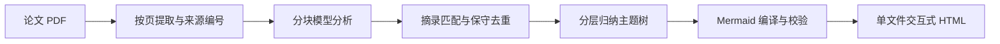

# 研脉 PaperWeave

把学术论文 PDF 转成带原文证据的 Mermaid 导图和可离线打开的交互式 HTML 阅读看板。

PaperWeave 按页提取论文，使用可配置的模型接口逐块分析，再把研究问题、方法、贡献、实验结论与局限组织成主题树。每个内容节点保留来源编号、PDF 物理页码和原文摘录，方便从分析结果回到原文。


## 使用文档

| 文档 | 内容 |
|---|---|
| [完整图文操作手册](docs/评委使用说明.md) | 从环境安装、接口配置到上传、节点阅读、证据定位、导出和离线检查；含 12 张实际操作截图 |
| [操作手册与配图下载包](docs/downloads/PaperWeave-评委操作手册.zip) | Markdown、完整配图和操作验证记录；下载后先解压，保留 `images` 目录 |
| [Attention Is All You Need 案例测试记录](docs/Attention案例测试记录.md) | 真实 PDF 提取、分块覆盖、上传入口检查与已发现的问题 |
| [测试记录](docs/测试记录.md) | 自动化测试、页面检查、模拟接口演示和实际模型测试范围 |
| [复用与来源说明](THIRD_PARTY_NOTICES.md) | 上游项目、模块改造、依赖与许可证 |

完整操作手册保留了现场使用者的操作路径；本页主要介绍项目功能、运行方式与工作原理。

## 功能

- **按页解析 PDF**：提取 Markdown 文本，记录章节、物理页码和稳定来源 ID。
- **分块分析长文**：逐块处理全部已提取来源，保存每块的处理记录，再分层归纳主题。
- **证据关联**：节点附原文摘录与页码，标明摘录匹配、分析者推断或未匹配状态。
- **两种 Mermaid 视图**：思维导图与层级结构关系图，支持平移、缩放和主题收起/展开。
- **交互阅读**：节点搜索、局限与边界筛选、原文窗口、可选内嵌 PDF、深浅主题和键盘操作。
- **独立交付**：单文件 HTML 内嵌脚本、样式、分析数据和可选 PDF，保存后可以离线阅读。
- **多格式导出**：HTML、SVG、Mermaid 源码和分析 JSON。
- **接口配置**：通过 Base URL、API Key 和模型 ID 连接 Chat Completions 兼容接口。

## 先体验已有示例

在项目目录依次打开 `outputs` → `teaching-demo`，双击 `dashboard.html`，选择 Edge 或 Chrome 打开。查看已有看板不需要启动 Python 服务或连接网络。

自带示例来自合成教学 PDF 和确定性测试响应，页面会明确标注。它用于演示交互，不代表真实模型对学术论文的分析效果。

## 环境与安装

当前在 Windows、Python 3.12、Microsoft Edge 上运行并测试。项目声明支持 Python 3.10 及以上，建议使用已经测试的 Python 3.12；其他系统尚未在本机验证。

在包含 `pyproject.toml` 和 `requirements.txt` 的项目根目录打开 PowerShell，逐行执行：

```powershell
py -3.12 -m venv .venv
.\.venv\Scripts\python.exe -m pip install -r requirements.txt
.\.venv\Scripts\python.exe -m pip install -e . --no-deps
```

程序通过 Playwright 调用 Chromium 内核校验、渲染 Mermaid，会依次尝试本机 Edge、Chrome 和已安装的 Playwright Chromium。找不到可用浏览器时执行：

```powershell
.\.venv\Scripts\python.exe -m playwright install chromium
```

正常运行不需要 Node。仓库已包含构建好的 `src/paperweave/static/mermaid.bundle.js`；只有修改浏览器依赖后才需要使用 Node 20+ 重新构建：

```powershell
npm ci
npm run build
```

## 配置模型接口

### 1. 创建配置文件

```powershell
if (-not (Test-Path -LiteralPath ".env")) {
    Copy-Item -LiteralPath ".env.example" -Destination ".env"
}
notepad .env
```

在 `.env` 中填写三项真实参数，替换模板中的占位内容：

```dotenv
LLM_BASE_URL=https://your-provider.example/v1
LLM_API_KEY=填写自己的API密钥
LLM_MODEL=填写服务商提供的准确模型ID
```

- Base URL 可以是 `https://host/v1`，程序会追加 `/chat/completions`；也支持完整的 Chat Completions 接口地址。
- 模型 ID 以服务商文档和账号权限为准。程序不固定模型或供应商，也不发送特定模型才支持的温度或 JSON 模式参数。
- 系统环境变量优先于 `.env`。修改配置后应退出旧服务并重新启动，再刷新页面。
- 原文片段会发送到配置的模型服务。生成时必须能连接该服务；使用远端服务时需要网络，生成后的 HTML 可以离线打开。
- `.env` 只保存在本机。密钥不写入源码、分析结果和导出的 HTML，也不应提交到 Git。

### 2. 可选参数

| 参数 | 默认值 | 作用 |
|---|---|---|
| `CHUNK_CHARS` | `10000` | 分析块的字符预算，包含序列化来源信息；范围 2000–24000 |
| `LLM_MAX_TOKENS` | `5000` | 单次请求的输出 token 上限；范围 512–32000 |
| `LLM_TIMEOUT` | `180` | HTTP 请求超时设置，单位为秒，必须大于 0 |
| `LLM_RETRIES` | `2` | 连接或部分服务错误的重试次数；范围 0–5 |
| `EMBED_PDF` | `1` | 是否把原 PDF 内嵌到看板和分析 JSON；设为 `0` 可减小文件 |

### 3. 检查本地配置

```powershell
.\.venv\Scripts\python.exe -m paperweave doctor
```

该命令检查配置完整性、浏览器和 Mermaid 资源，不调用真实 API。因此检查通过不等于密钥和模型权限已经验证。

## 通过网页使用

### 启动

```powershell
.\.venv\Scripts\python.exe -m paperweave serve
```

浏览器打开 [本地上传页](http://127.0.0.1:8765/)，保持服务终端运行。端口被占用时可指定其他端口：

```powershell
.\.venv\Scripts\python.exe -m paperweave serve --port 8770
```

此时打开 `http://127.0.0.1:8770/`。页面地址以启动终端输出为准。

### 上传与生成

1. 查看右侧“导入论文”下方的配置状态，确认模型已配置。
2. 点击“选择或拖入一篇论文”，选择文本型 PDF；也可把文件拖进选择框。单个文件不超过 80 MB。
3. 核对文件名，点击“生成阅读看板 →”。
4. 等待按页提取、全文分块分析、主题合并和 Mermaid 校验完成。
5. 出现“离线看板已生成”后，点击“打开离线论文看板 ↗”。

服务只监听本机，最多允许三个排队或执行中的任务，分析任务按顺序执行。进度按处理阶段更新，不会每秒增加；遇到错误时页面显示原因，正常流程不会自动切换成教学响应。

### 阅读与核对

- **左侧研究索引**：选择节点；搜索节点标题、分析、解释与证据摘录；筛选“局限与边界”。搜索框不是对所有 PDF 原文的完整检索。
- **中间导图**：切换“思维导图 / 结构关系”；拖拽平移、滚轮或按钮缩放；点击“适应”“收起主题”“展开全部”调整视图。
- **右侧阅读笔记**：查看分析、通俗解释、原文摘录及匹配状态；点击“PDF 第 N 页”查看上下文，再切换“原始 PDF”核对原页。
- **原文全文**：点击导图下方“原文全文 ↗”，打开按页提取文本。

页码是从 1 开始的 PDF 物理页序，可能与印刷页码不同。结构关系图的连线表示层级归属，不直接表示因果或方法执行顺序。

### 导出与离线打开

1. 点击右上角“保存看板 ↓”，下载 `paperweave.html`。其他按钮可下载 SVG、Mermaid 源码和 JSON。
2. 在服务终端按 Ctrl+C，等待服务退出，再断开网络。
3. 把下载的 HTML 复制到另一个文件夹，用浏览器重新打开本地文件。
4. 测试搜索、节点证据、图类型切换、缩放与导出，确认无需后端服务。

如果下载文件找不到，在浏览器按 Ctrl+J 查看下载记录。截图与完整点击说明见 [图文操作手册](docs/评委使用说明.md)。

## 通过命令行使用

```powershell
.\.venv\Scripts\python.exe -m paperweave analyze "D:\papers\论文.pdf" -o "outputs\我的论文"
```

程序自动完成提取、分析、主题归纳和看板生成，不要求输入提示词或选择模板。处理状态输出到终端；失败时返回非零退出码并显示原因。

也可指定配置文件：

```powershell
.\.venv\Scripts\python.exe -m paperweave analyze "D:\papers\论文.pdf" -o "outputs\我的论文" --env ".env.local"
```

完成后直接打开输出目录里的 `dashboard.html`。

## 输出文件

命令行使用 `-o` 指定目录。网页上传结果保存在 `outputs/runs/<任务ID>/`，服务重启后可以直接从目录打开已生成结果。

| 文件 | 内容 |
|---|---|
| `input.pdf` | 网页上传服务保存的原件；看板中可能显示这一内部文件名 |
| `dashboard.html` | 内嵌 Mermaid、样式、交互脚本、分析数据、原文和可选 PDF 的离线看板 |
| `mindmap.mmd` | Mermaid mindmap 格式源码 |
| `flowchart.mmd` | Mermaid 层级结构关系图源码 |
| `analysis.json` | 内容节点、主题树、证据、覆盖记录、模型调用统计与校验信息 |
| `extracted.md` | 带物理页码锚点的全文提取结果 |
| `extracted.json` | 按页文本、章节和稳定来源 ID |
| `chunk_report.json` | 每个分析块的来源 ID、页码、发现数与处理状态 |

默认内嵌 PDF 会增大 HTML 与 JSON。`EMBED_PDF=0` 时仍保留按页提取文本和来源，原始 PDF 预览不可用。内嵌 PDF 的页码跳转取决于浏览器自带阅读器，必要时手动翻页。

## 工作原理



### 按页提取与来源保留

使用 PyMuPDF4LLM 按页生成 Markdown，读取异常时使用 PyMuPDF 备用提取并提示。解析器结合元数据、字号、文字方向及标题规则识别论文题目与章节；每段来源记录稳定 ID、物理页码、章节和原文。

来源段最长 1200 字符，再按照 `CHUNK_CHARS` 预算组成分析块。所有已提取来源按顺序进入分析，不只读取摘要或前几页。低文字页会发出警告；当前未自动执行 OCR。

### 结构化分析与证据匹配

每块调用一次模型，要求返回结构化 JSON，包含节点类别、详细分析、通俗解释、推断标记及原文引文。程序检查返回结构和证据 ID，证据必须指向本块提供的来源；结构错误时最多进行两次修复请求。

匹配检查对引文与提取文本做 Unicode 和空白规范化，确认摘录是否存在。未匹配节点仍会显示，并保留提醒。**摘录存在不等于它支持模型结论**，语义与实验数值需要结合上下文核对。

### 去重与分层归纳

只在类别、推断标记、详细陈述一致且标签一致或高度相似时合并节点，并保留各条证据，减少误合并相反结论的风险。

主题归纳以每批最多 24 个节点逐层进行，要求每个输入 ID 恰好分配一次。导出前比较主题树叶子与完整分析节点集合，发现遗漏或重复时停止输出。

### Mermaid 校验与离线打包

程序从节点树编译两种 Mermaid 源码，调用实际 `mermaid.parse()` 校验，并用 Chromium 渲染思维导图。语法失败时尝试简化标签后重试，仍失败则报错。

HTML 内嵌渲染器、CSS、脚本、数据及可选 PDF，不使用 CDN 或在线字体。生成之后，搜索、节点详情、双图切换和导出均在浏览器本地完成。

## 项目结构

```text
src/paperweave/
├─ config.py       # 环境变量与本地配置
├─ parser.py       # PDF 按页提取、来源编号与分块
├─ llm.py          # Chat Completions 请求、重试与 JSON 修复
├─ analysis.py     # 证据检查、节点去重与主题归纳
├─ pipeline.py     # 串联处理步骤并保存过程文件
├─ render.py       # Mermaid 校验与单文件 HTML 生成
├─ server.py       # 本地上传与任务接口
├─ __main__.py     # 命令行入口
├─ static/         # 页面、样式、脚本与离线 Mermaid
└─ vendor/         # 保留来源声明的复用模块
```

`examples/` 包含合成教学 PDF 与示例生成脚本；`tests/` 包含自动化测试；`docs/` 包含操作手册、案例记录和测试说明。

## 测试与已知限制

运行测试：

```powershell
.\.venv\Scripts\python.exe -m pip install -r requirements-dev.txt
.\.venv\Scripts\python.exe examples/build_demo.py
.\.venv\Scripts\python.exe -m pytest -q --basetemp .test-tmp
```

已执行的测试覆盖全文来源分配、主题归纳完整性、引文标记、JSON 修复、鉴权错误脱敏、PDF 错误处理、本地 HTTP 上传、浏览器交互、移动布局与离线导出。详细范围和机器记录见 [测试记录](docs/测试记录.md)。

当前需要留意：

- 扫描件、加密文件、图像公式及纯图表需要额外预处理或人工核对；文本型 PDF 也可能漏提取图注。
- PyMuPDF4LLM 生成的 Markdown 可能把小数或公式拆开，关键数值应与原页对照。
- 《Attention Is All You Need》已完成真实 PDF 提取与分块检查，但没有进行真实外部模型分析；第 14 页存在图注提取缺口，见 [案例记录](docs/Attention案例测试记录.md)。
- 自动化测试与操作截图使用明确标注的确定性响应，不能证明真实模型的论文理解质量。
- 当前没有页面内取消和断点续跑；重新提交会从头处理。全部分块处理完成也不等于全文科学信息没有遗漏。

## 常见问题

| 问题 | 处理方式 |
|---|---|
| Python 不启动或跳到商店 | 使用已安装的 Python 创建虚拟环境，之后执行 `.venv` 内的完整 Python 路径 |
| 模型未配置或 ID 无效 | 检查 `.env` 的三项真实参数；注意系统环境变量优先，并在修改后重启服务 |
| 401 / 403 | 检查密钥、接口地址及模型访问权限 |
| 超时 / 429 | 检查网络和限流；根据服务能力调整超时、重试或分析块大小 |
| 模型输出达到 token 上限 | 减小 `CHUNK_CHARS` 或增大 `LLM_MAX_TOKENS`，再重新生成 |
| 没有可用浏览器 | 安装 Edge / Chrome，或执行 Playwright Chromium 安装命令 |
| 原始 PDF 不显示或不跳页 | 使用提取文本查看物理页码，或另开原件手动定位 |
| 导图文字太小 | 缩放或收起主题，通过索引和右侧阅读笔记查看详情 |
| 服务重启后找不到任务 | 直接打开 `outputs/runs/<任务ID>/dashboard.html` 或此前下载的 HTML |

## 开源与复用

PaperWeave 使用 ScholarFlow 的数据模型和部分标题、章节识别代码，改造 mindmap-generator 的递归 Mermaid 编译方式，集成 PyMuPDF4LLM / PyMuPDF 和 Mermaid，并新增按页证据、分层归纳完整性检查、离线看板及本地上传流程。

新增代码采用 AGPL-3.0-or-later。上游 MIT 版权、各依赖授权文本与具体改造来源保留在 [LICENSE](LICENSE)、[THIRD_PARTY_NOTICES.md](THIRD_PARTY_NOTICES.md) 和 [licenses/](licenses/) 中。
