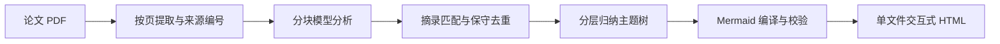

# 工作原理

[← 返回 README](../README.md)

## 按页提取与来源保留

使用 PyMuPDF4LLM 按页生成 Markdown，读取异常时使用 PyMuPDF 备用提取并提示。解析器结合元数据、字号、文字方向及标题规则识别论文题目与章节；每段来源记录稳定 ID、物理页码、章节和原文。

来源段最长 1200 字符，再按照 `CHUNK_CHARS` 预算组成分析块。所有已提取来源按顺序进入分析，不只读取摘要或前几页。低文字页会发出警告；当前未自动执行 OCR。

## 结构化分析与证据匹配

每块调用一次模型，要求返回结构化 JSON，包含节点类别、详细分析、通俗解释、推断标记及原文引文。程序检查返回结构和证据 ID，证据必须指向本块提供的来源；结构错误时最多进行两次修复请求。

匹配检查对引文与提取文本做 Unicode 和空白规范化，确认摘录是否存在。未匹配节点仍会显示，并保留提醒。**摘录存在不等于它支持模型结论**，语义与实验数值需要结合上下文核对。

## 去重与分层归纳

只在类别、推断标记、详细陈述一致且标签一致或高度相似时合并节点，并保留各条证据，减少误合并相反结论的风险。

主题归纳以每批最多 24 个节点逐层进行，要求每个输入 ID 恰好分配一次。导出前比较主题树叶子与完整分析节点集合，发现遗漏或重复时停止输出。

## Mermaid 校验与离线打包

程序从节点树编译两种 Mermaid 源码，调用实际 `mermaid.parse()` 校验，并用 Chromium 渲染思维导图。语法失败时尝试简化标签后重试，仍失败则报错。

HTML 内嵌渲染器、CSS、脚本、数据及可选 PDF，不使用 CDN 或在线字体。生成之后，搜索、节点详情、双图切换和导出均在浏览器本地完成。

## 延伸阅读

更完整的形式化描述、算法伪代码与威胁模型见 [技术报告](../report/report.pdf)。
