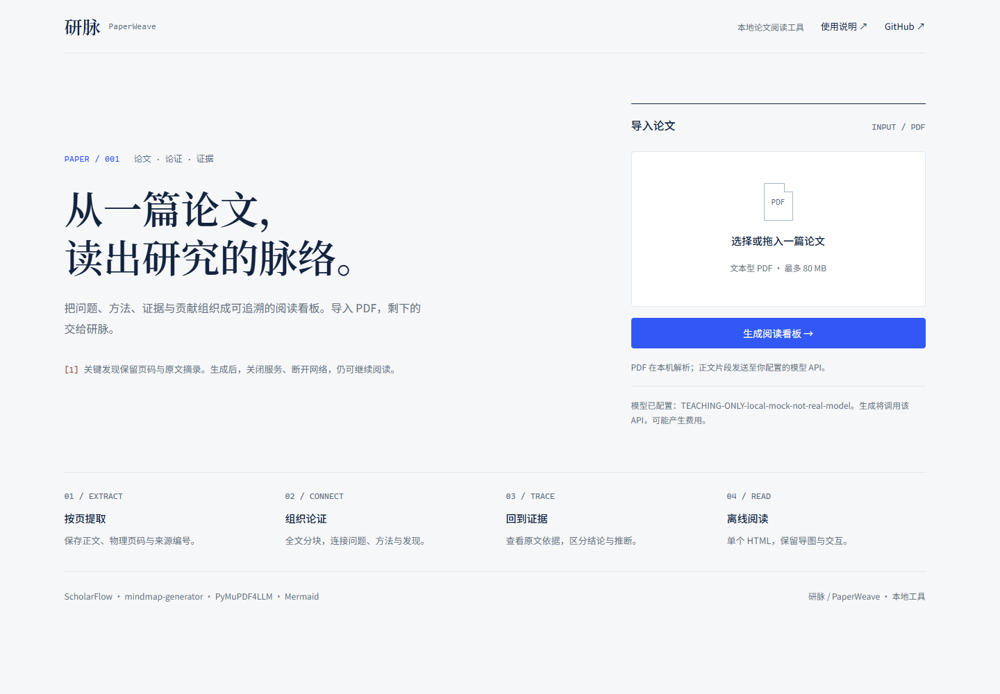
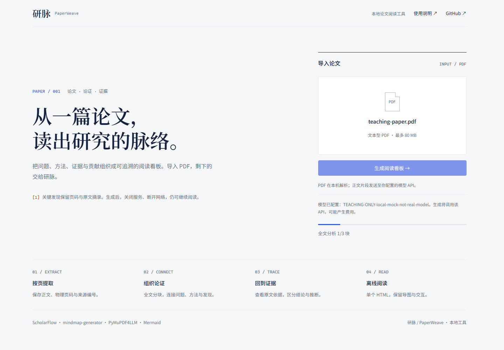
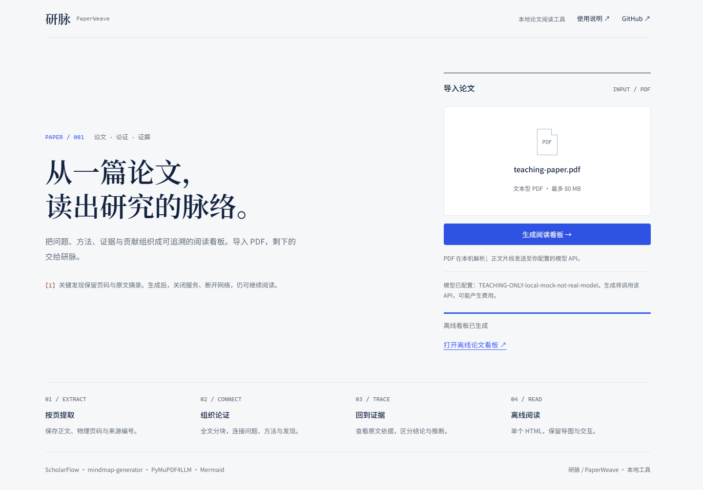
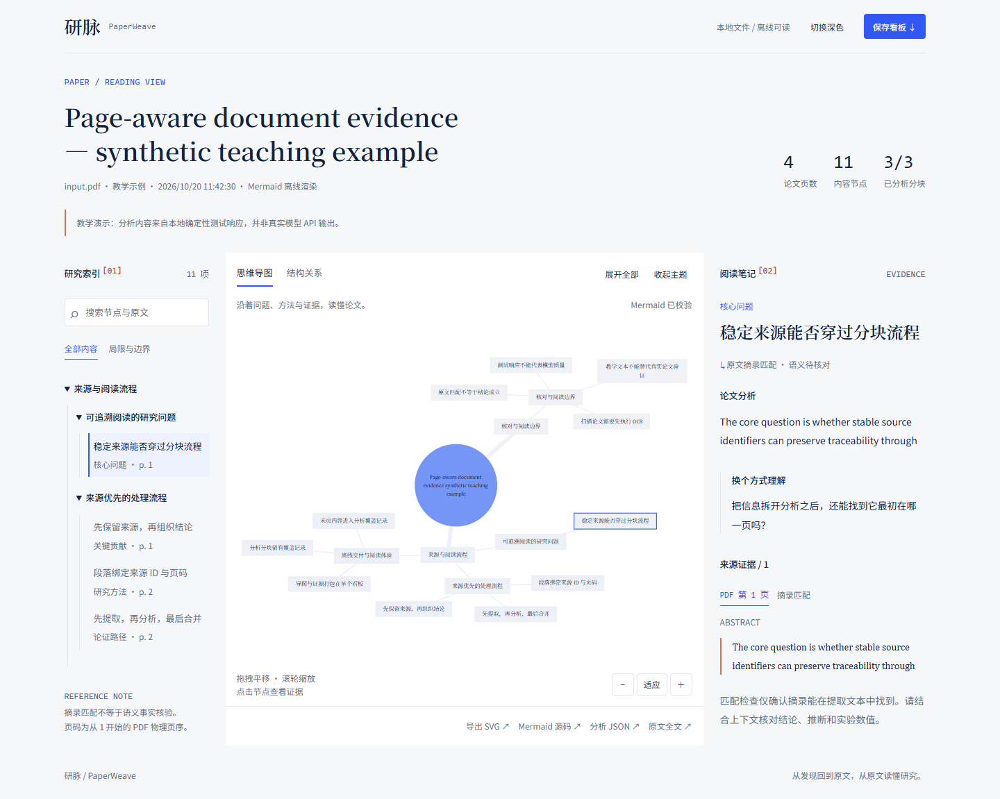
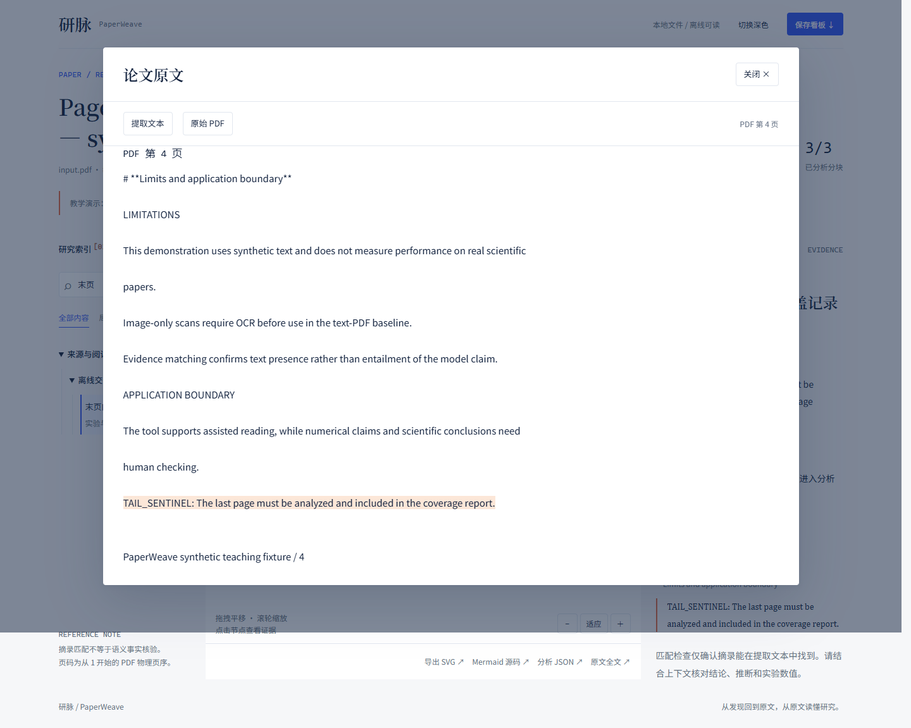
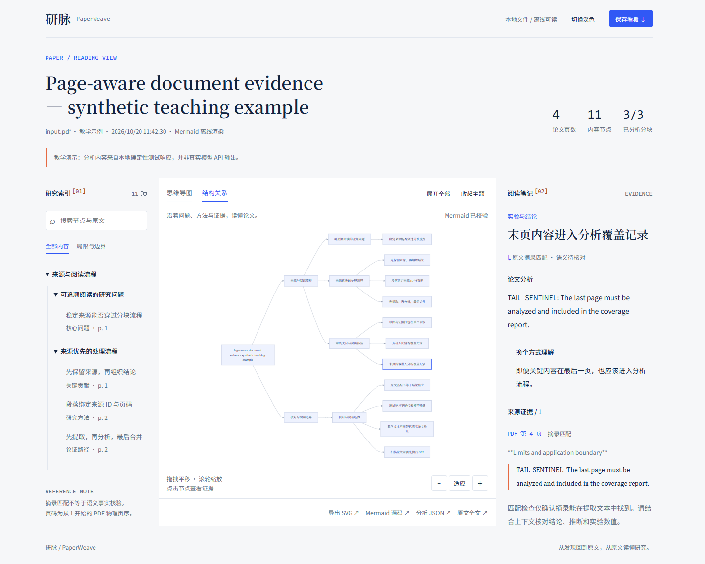
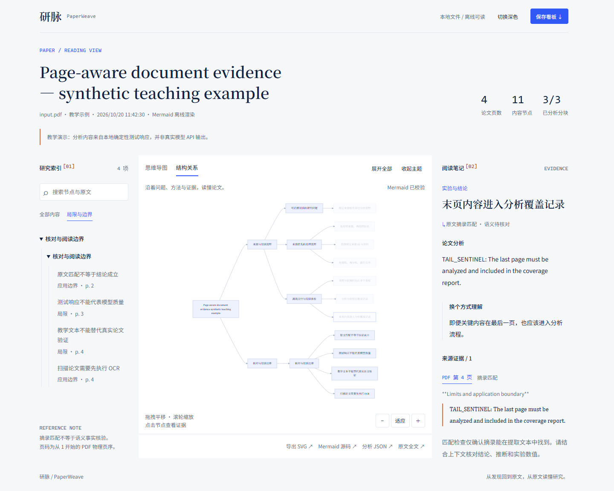
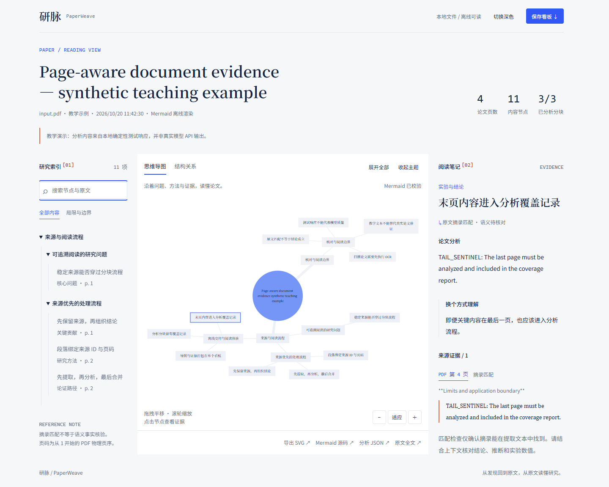

# 研脉 PaperWeave · 评委使用说明（完整图文操作版）

更新日期：2026 年 10 月 20 日。适用于 Windows、Edge / Chrome 和当前 PaperWeave 页面。

这份说明按实际操作顺序编写。每一步说明**在哪里操作、如何操作、应看到什么、遇到问题怎么办**。评委不需要编写提示词或手工整理论文结构。

> **先说明当前状态：**本机真实模型接口尚未配置，因此目前不能完成《Attention Is All You Need》的真实模型分析。本文完整流程截图来自“4 页教学 PDF＋本地确定性模拟接口”，用于展示操作方法；页面会保留教学标识。这些截图和教学结果不能作为真实论文分析质量或主办方指定模型验收通过的证明。

## 先选择与你的情况对应的入口

| 当前情况 | 从哪里开始 | 可以检查什么 |
|---|---|---|
| 参赛方已启动系统，且模型已配置 | 直接进入第 3 节 | 上传新论文、自动分析及离线交付的完整流程 |
| 收到源码，需要自行启动 | 按第 1、2 节准备，再进入第 3 节 | 配置成功后完成完整流程 |
| 暂无模型接口，只想体验已有看板 | 先看下面的“离线体验” | 教学示例的导图、搜索、证据和导出交互 |

**离线体验：**在项目文件夹依次打开 `outputs` → `teaching-demo`，双击 `dashboard.html`。如果系统询问打开方式，选择 Edge 或 Chrome。看到顶部“教学演示”提示后，可从第 5 节开始操作。这里不会重新分析你选择的论文。

完整验收顺序：**准备环境 → 配置模型 → 启动 → 上传 → 等待 → 打开结果 → 核对证据 → 导出 → 关闭服务 → 离线重开 → 记录结果。**

## 1. 找到项目并打开终端

这部分通常由参赛方完成。现场已经打开上传页时，评委可跳过。

### 1.1 找到正确的项目文件夹

1. 如果拿到的是压缩包，右键压缩包，选择“全部解压缩”，进入解压后的文件夹。
2. 如果拿到的是 GitHub 仓库，使用有访问权限的账号下载或克隆后，进入仓库目录。
3. 确认当前文件夹里能看到 `README.md`、`pyproject.toml`、`requirements.txt`、`src`、`examples`、`outputs`。

**判断标准：**同时看到这些文件，才是下文所说的“项目根目录”。不要在 `docs`、`src` 或尚未解压的压缩包中执行命令。

### 1.2 在这个文件夹打开 PowerShell

1. 保持文件资源管理器停留在项目根目录。
2. 点击资源管理器顶部地址栏，输入 `powershell`，按 Enter。
3. 在打开的窗口中输入下面的命令，按 Enter：

```powershell
Get-Location
```

**应看到：**输出路径就是项目根目录。之后所有命令均在此窗口中执行。复制命令时不需要复制 Markdown 的三个反引号。

### 1.3 首次安装运行环境

参赛方已经安装好项目根目录的 `.venv` 时，跳到第 2 节。否则先执行：

```powershell
py -3.12 --version
```

**应看到：**`Python 3.12.x`。

如果还没有 Python，在 Windows 10/11 可按以下步骤安装：

1. 打开 Microsoft Store，搜索 `Python 3.12`。
2. 确认发布者为 **Python Software Foundation**，点击“获取”或“安装”。
3. 安装结束后关闭旧 PowerShell，回到项目根目录重新打开 PowerShell。
4. 执行 `python3.12 --version`，确认输出 `Python 3.12.x`。安装方法及命令后缀见 [Python 官方 Windows 安装说明](https://docs.python.org/3.12/using/windows.html#the-microsoft-store-package)。
5. 如果 `py -3.12 --version` 仍不可用，但 `python3.12 --version` 成功，把下面第一行创建环境的命令改成 `python3.12 -m venv .venv`；后续均使用同一个 `.venv` 内的 Python。

如果官方商店或安装权限不可用，由参赛方按 [Python 官方 Windows 下载入口](https://www.python.org/downloads/windows/) 准备相应运行环境，再完成上述版本检查。

然后逐行执行，上一行完成后再执行下一行：

```powershell
py -3.12 -m venv .venv
.\.venv\Scripts\python.exe -m pip install -r requirements.txt
.\.venv\Scripts\python.exe -m pip install -e . --no-deps
```

**应看到：**命令正常结束，项目目录中出现 `.venv`。安装依赖时需要网络。

系统已有 Edge / Chrome 时，程序会尝试使用它们。若后续提示没有可用浏览器，执行：

```powershell
.\.venv\Scripts\python.exe -m playwright install chromium
```

这些命令直接使用虚拟环境内的 Python，无需执行激活脚本。正常运行也不需要另外安装 Node 或在线 Mermaid 脚本。

## 2. 配置模型并启动系统

### 2.1 建立本地配置文件

在项目根目录的 PowerShell 中执行：

```powershell
if (-not (Test-Path -LiteralPath ".env")) {
    Copy-Item -LiteralPath ".env.example" -Destination ".env"
}
notepad .env
```

**应看到：**记事本打开 `.env`。上述操作只在文件不存在时复制模板，保留已有配置。

### 2.2 填写三项真实接口参数

由参赛方将下面三项替换为主办方或服务商实际提供的值：

```dotenv
LLM_BASE_URL=https://主办方提供的接口地址/v1
LLM_API_KEY=主办方提供的真实密钥
LLM_MODEL=主办方提供的准确模型ID
```

以上只是格式说明，不能把中文占位内容原样当作有效参数。主办方要求 DeepSeek V4 Pro 时，使用其提供的准确模型 ID，不能根据展示名称猜测。其余参数可先保留模板默认值。

在记事本按 Ctrl+S 保存，然后关闭记事本。文件名应为 `.env`，不能变成 `.env.txt`。密钥只保存在本机，不写入评委记录，不提交 GitHub。

如果服务已经启动，修改 `.env` 后应在原服务终端按 Ctrl+C，等服务退出后重新执行启动命令，再刷新页面；不要只刷新浏览器。进程中已经读取的环境变量可能保留旧配置。

### 2.3 检查配置和浏览器

在同一个 PowerShell 窗口执行：

```powershell
.\.venv\Scripts\python.exe -m paperweave doctor
```

**应看到：**“配置完整，模型 ID：……；浏览器和 Mermaid 可用。尚未调用真实 API。”

如果看到“处理失败”，先处理该提示再继续。这个命令只检查本地配置与浏览器，不证明密钥有效、模型可调用或科学分析正确。

### 2.4 启动上传服务

执行：

```powershell
.\.venv\Scripts\python.exe -m paperweave serve
```

**应看到：**终端输出本地入口 `http://127.0.0.1:8765`，并持续运行。不要关闭这个窗口。

打开浏览器，在顶部地址栏输入 `http://127.0.0.1:8765/`，按 Enter。不要把地址输入搜索引擎的搜索框。

如果 8765 端口被占用，在终端停止本次启动后改用：

```powershell
.\.venv\Scripts\python.exe -m paperweave serve --port 8770
```

此时在浏览器输入 `http://127.0.0.1:8770/`。本次会话此前的演示服务使用 8770；**以你当前终端输出为准，页面地址与启动端口必须一致**。

## 3. 选择并上传论文

### 3.1 检查上传页面

**操作位置：**页面右侧“导入论文”区域。

1. 找到文件选择框下方的模型状态文字。
2. 确认显示“模型已配置：……”且模型 ID 符合本次验收要求。
3. 如果显示“尚未配置模型”，先返回第 2 节；不要把缺少配置时的报错当作论文分析结果。

下图是教学模拟接口的实际页面，模型名中的 `TEACHING-ONLY` 表明它不是正式验收接口。截图中的临时本地端口只用于取图测试。



### 3.2 准备测试 PDF

可以使用评委自行准备的论文。以《Attention Is All You Need》为例：

1. 打开 [arXiv PDF（1706.03762v7）](https://arxiv.org/pdf/1706.03762v7)。
2. 若浏览器直接下载，找到下载的 PDF；若浏览器打开 PDF 阅读器，点击阅读器上的下载/保存图标，将文件保存到电脑。
3. 记下保存位置，例如“下载”文件夹，并确认保存的是 `.pdf` 文件。

输入限制：文本型 PDF，单个文件不超过 80 MB。扫描件需要先 OCR，加密文件需要先提供可打开的未加密副本。使用原始论文作为新输入，不上传程序已经导出的 HTML。

### 3.3 选择文件

1. 点击右侧写有“选择或拖入一篇论文”的大框。
2. 在系统文件选择窗口中进入 PDF 所在文件夹。
3. 单击目标 PDF，再点击“打开”。也可以从资源管理器把 PDF 拖入页面的选择框。

**应看到：**文件选择框显示刚才选中的 PDF 名称。选错文件时，再次点击选择框，重新选择。

下图选择的是项目自带 `examples/teaching-paper.pdf`，不是《Attention Is All You Need》；它用于本文操作取图。


### 3.4 开始生成

1. 核对文件名。
2. 点击选择框下方蓝色“生成阅读看板 →”按钮一次。
3. 保持服务终端和当前页面打开，不重复提交。

**应看到：**按钮暂时不可用，下方出现进度条和处理状态。PDF 在本机解析，正文片段发送到配置的模型 API。

## 4. 等待处理并打开结果

### 4.1 查看实际处理进度

**操作位置：**上传区域下方新出现的进度条与状态文字。

状态会随处理更新，可能看到：

| 阶段 | 示例状态文字 | 正在做什么 |
|---|---|---|
| 提取 | 按页提取 PDF 正文 | 提取正文并保留物理页码与来源编号 |
| 分析 | 全文分析 1/3 块 | 逐块请求所配置的模型接口 |
| 合并 | 合并主题并核对节点完整性 | 组织主题并检查是否丢失节点 |
| 校验 | 校验 Mermaid 并生成离线看板 | 校验图形语法，打包 HTML |
| 完成 | 离线看板已生成 | 可打开本次任务结果 |

较快的阶段可能在两次刷新之间完成，不一定逐条停留。块数随论文和配置变化，不要求每篇都是 3 块或 7 块。处理时间取决于论文长度、接口速度和重试情况。

**进度长时间不变时：**先检查服务终端与接口状态，不要重复点击生成。进度按处理阶段更新，并非每秒增加；默认单次模型请求超时为 180 秒，且可能重试，因此同一块超过 3 分钟也不一定是程序失去响应。若怀疑卡住，请记录当前状态、任务 ID 和时间，由参赛方确认请求是否仍在运行。

当前没有页面内的取消或断点续跑按钮。如确定需要中止，在服务终端按 Ctrl+C，等待 Python 服务进程完全退出；若仍未退出，交由参赛方处理，不要同时启动另一份任务。重新启动并上传后会从头生成，之前的部分文件不应当作完成结果。



### 4.2 识别成功与失败

**成功时：**状态显示“离线看板已生成”，下方出现“打开离线论文看板 ↗”链接。



**失败时：**页面显示错误提示，没有成功链接。记录提示；按第 10 节处理后重新点击生成。不要直接打开旧教学看板来替代这次失败任务。

### 4.3 打开本次结果

点击“打开离线论文看板 ↗”。当前页面进入论文看板。

**应看到：**顶部论文标题与统计，下方是左侧研究索引、中间导图、右侧阅读笔记。页面警告或教学提示应保持可见。



## 5. 阅读与核对论文分析

### 5.1 先核对顶部信息

查看论文标题、页数、内容节点数、已分析分块，以及文件与模型信息。

- 标题、页数应对应本次输入。
- “已分析分块”显示“已完成数/总数”，例如 `3/3`。
- 上传服务内部把原件保存为 `input.pdf`，看板文件名可能显示该内部名称。可结合标题、页数、任务目录中的原件和 `analysis.json` 的 SHA-256 核对输入。
- 已完成全部分块不等于图表、公式及所有科学信息均已被正确理解。警告、未匹配证据和空缺维度应记录下来。

### 5.2 点击节点查看分析

1. 在左侧研究索引找到一个具体内容节点，单击它；也可单击中间导图中的内容节点。
2. 查看右侧“阅读笔记”。
3. 依次阅读节点标题、“论文分析”、“换个方式理解”和“来源证据”。

**应看到：**右侧内容随选中节点变化。选中内容节点用于查看详情；点击主题节点则可能展开或收起分支。

正式评审时，建议分别抽查研究问题、方法、关键贡献、实验结果，以及局限/边界。不存在的维度应如实显示未提取，不应要求程序编造补齐。

### 5.3 搜索一个具体发现

以教学示例为例，可重复下面的操作：

1. 点击左侧“搜索节点与原文”输入框。
2. 输入 `末页`。
3. 单击筛选出的“末页内容进入分析覆盖记录”节点。

**应看到：**左侧只剩相应匹配项，右侧显示该节点的分析和证据。真实 Transformer 论文可改搜 `attention`、`BLEU` 或生成节点中实际出现的术语。


搜索范围是节点标题、分析、解释和证据摘录，**不是对每一页原始全文的完整检索**。搜索不到时，可点击底部“原文全文 ↗”查看全文。

恢复全部结果：点击搜索框，按 Ctrl+A，再按 Backspace；若此前开启了“局限与边界”，还需点击“全部内容”。

### 5.4 点击页码回到原文

1. 保持一个节点处于选中状态。
2. 在右侧“来源证据”中找到“PDF 第 N 页”按钮。
3. 单击该按钮。

**应看到：**弹出“论文原文”窗口，默认展示“提取文本”，并定位到相应物理页。摘录可精确找到时可能高亮；未高亮时应结合页码和上下文人工核对。

下图教学节点对应 PDF 第 4 页。



页码统一指**从 1 开始的 PDF 物理页序**，可能与论文印刷页码不同。

### 5.5 切换到原始 PDF

1. 在“论文原文”窗口顶部点击“原始 PDF”。
2. 对照原始页面检查摘录、表格、公式和数值。
3. 需要回到提取结果时点击“提取文本”。
4. 检查完成后点击窗口右上角“关闭 ×”。


如果浏览器没有自动跳到相应页，使用 PDF 阅读器的页码框手动跳转。若提示“此看板未内嵌原 PDF”，使用“提取文本”，同时另开原件核对；这是 `EMBED_PDF=0` 时的行为。

### 5.6 理解证据状态

| 右侧显示 | 含义 | 评委下一步 |
|---|---|---|
| 原文摘录匹配 · 语义待核对 | 摘录能在提取文本中找到 | 检查其上下文是否真正支持节点结论 |
| 分析者推断 · 请核对依据 | 节点包含分析推断 | 区分推断与作者明示的结论、局限 |
| 原文摘录未匹配 | 摘录未通过当前匹配检查 | 回到原页重点复查，不直接采信 |

摘录匹配与 Mermaid 语法校验都不等于科学事实验证。实验数值、适用边界和作者贡献需要人工核对。

## 6. 完整操作导图与筛选

### 6.1 切换图类型

1. 在中间导图顶部点击“结构关系”。
2. 等待状态从“正在渲染…”恢复为“Mermaid 已校验”。
3. 检查结构关系图中的节点能否点击并更新阅读笔记。
4. 点击“思维导图”回到原视图。



连线表示层级归属，不能直接视为因果关系或方法执行顺序。

### 6.2 放大、缩小与平移

**操作位置：**中间导图画布及其右下角。

1. 点击 `＋` 放大，点击 `−` 缩小；鼠标滚轮也可缩放。
2. 在画布空白位置按住鼠标左键并拖动，松开后停在新位置。
3. 找不到节点或图移出视野时，点击“适应”。

**应看到：**图的比例或位置变化，原有分析和证据不变。

### 6.3 收起与展开

1. 点击导图顶部“收起主题”。
2. 等待渲染完成，确认详细分支收起。
3. 点击“展开全部”，确认完整分支恢复。

### 6.4 只看局限与边界

1. 先清空搜索框，避免搜索条件叠加。
2. 点击左侧“局限与边界”。
3. 单击筛选后的节点，核对它是作者明示还是分析者推断。
4. 点击“全部内容”恢复。

**应看到：**左侧仅保留局限/边界节点，中间不匹配内容变淡。没有该类节点时应如实呈现空结果。



### 6.5 切换明暗与使用键盘

点击页面顶部“切换深色”，等待渲染完成；再次点击“切换浅色”可恢复。


键盘操作：Tab 移动焦点，内容节点 Enter / 空格选择；焦点位于画布时，方向键平移，`+` / `-` 缩放，`0` 适应画布。

## 7. 下载 HTML、SVG、Mermaid 和 JSON

### 7.1 保存可离线阅读的 HTML

1. 点击页面右上角“保存看板 ↓”。
2. 如果浏览器弹出保存窗口，选择一个便于找到的文件夹，例如桌面的“PaperWeave验收”，点击“保存”。
3. 如果没有弹窗，在浏览器按 Ctrl+J，打开下载记录。
4. 找到刚下载的 `paperweave.html`，选择“在文件夹中显示”或对应文件夹图标。

**应看到：**电脑上实际出现一个 HTML 文件，而不只是网页里出现下载提示。重复下载时浏览器可能添加 `(1)` 等后缀。

任务目录中原始文件叫 `dashboard.html`，按钮下载副本叫 `paperweave.html`，均可独立打开。

### 7.2 分别导出其他文件

**操作位置：**中间导图底部的导出按钮。

| 操作 | 应下载的文件 | 如何核对 |
|---|---|---|
| 点击“导出 SVG ↗” | `paper-mindmap.svg` 或 `paper-flowchart.svg` | 用浏览器打开，检查当前图像 |
| 点击“Mermaid 源码 ↗” | `mindmap.mmd` 或 `flowchart.mmd` | 用记事本打开，查看对应图类型的 Mermaid 源码 |
| 点击“分析 JSON ↗” | `analysis.json` | 用文本编辑器查看节点、来源、覆盖记录与模型调用统计 |

文件名随当前图类型变化。SVG 保存当前显示图像；Mermaid 文件是该图类型的完整源码，不等于当前收起状态的截图。可先点击“展开全部”再导出 SVG，便于保留完整图像。

每次下载后都可按 Ctrl+J 查找文件。正式验收应保存真实论文生成的 HTML、Mermaid 与 JSON，而不是只保存页面截图。

## 8. 关闭服务，真正离线重开

这一节使用第 7 节**刚下载的 HTML 文件**。

### 8.1 停止生成服务

1. 切换回运行 `paperweave serve` 的 PowerShell 窗口。
2. 在该窗口按 Ctrl+C。
3. 等待终端重新出现可输入命令的提示符。

### 8.2 断网并复制文件

1. 关闭 Wi-Fi 或断开有线网络。
2. 在资源管理器找到刚下载的 `paperweave.html`。
3. 选中它，按 Ctrl+C，进入另一个本地文件夹，再按 Ctrl+V。
4. 关闭此前的在线看板标签页，避免把已经打开的页面误当成重新加载的结果。

### 8.3 重新打开副本

1. 双击新文件夹中的 HTML；如有打开方式提示，选择 Edge / Chrome。
2. 检查地址栏是本地文件路径（`file://…`），不是 `http://127.0.0.1:…`。
3. 等待导图显示。

### 8.4 重复验收动作

- 在搜索框输入关键词，选择一个节点，确认阅读笔记更新。
- 点击节点证据页码，确认原文窗口仍能打开。
- 切换“结构关系”，再切回“思维导图”。
- 测试缩放、平移、收起、展开和明暗切换。
- 再导出一次 SVG / Mermaid / JSON，确认文件仍能下载。

**成功标准：**在生成服务停止、网络断开的情况下，新打开的本地副本仍能完成这些操作。

下图来自实际测试：两个本地测试服务已停止，浏览器设置为离线，再重新打开下载的 HTML，并复测了搜索和页码定位。



## 9. 找回任务和检查过程文件

### 9.1 找到本次任务目录

1. 在在线看板地址中找到任务 ID，例如 `/api/jobs/一串任务ID/files/dashboard.html`。
2. 打开项目根目录的 `outputs` → `runs`。
3. 打开名称与任务 ID 一致的文件夹。

目录里应包含：

```text
outputs/runs/<任务ID>/
├─ input.pdf          # 服务保存的输入原件
├─ dashboard.html     # 可直接双击的看板
├─ mindmap.mmd        # 思维导图源码
├─ flowchart.mmd      # 结构关系图源码
├─ analysis.json      # 分析节点、证据和校验信息
├─ extracted.md       # 带物理页码锚点的提取全文
├─ extracted.json     # 按页文本与来源编号
└─ chunk_report.json  # 分块处理记录
```

失败任务可能只留下部分文件。服务重启后旧任务链接可能失效，但已生成文件仍在；此时直接双击对应目录的 `dashboard.html`。

### 9.2 检查分块和来源

用记事本或文本编辑器打开：

- `chunk_report.json`：查看每块页码、来源 ID、发现数及 `status` 是否为 `analyzed`。
- `analysis.json`：查看 `coverage`、`model_info`、`warnings`、`validation` 及节点证据。
- `extracted.json` / `extracted.md`：与原 PDF 核对是否漏页、漏图注或误读数值。

本地文件中的模型标识和调用计数仅是程序记录；评审指定模型时，可结合主办方可核验的服务调用记录，不能仅凭页面文字认定调用了某个真实模型。

## 10. 操作卡住时的处理顺序

| 看到的情况 | 具体处理 |
|---|---|
| 上传页打不开 | 查看服务终端是否仍运行；将终端实际输出的地址重新粘贴到浏览器地址栏 |
| 找不到 `.venv\Scripts\python.exe` | 确认位于项目根目录，并完成第 1.3 节；若参赛方使用其他环境，使用其提供的等价命令 |
| 提示 `No module named paperweave` | 在项目根目录执行 `.\.venv\Scripts\python.exe -m pip install -e . --no-deps`，再启动 |
| 尚未配置模型 | 请参赛方按第 2 节填写三项真实参数；确认文件不是 `.env.txt`，保存后刷新页面。若使用环境变量，以实际生效配置为准 |
| 模型 API 拒绝访问 / 401 / 403 | 检查密钥、Base URL 与模型权限，修正后重新生成；不要把密钥贴到评委记录 |
| 超时 / 429 | 记录原提示，请参赛方检查网络与服务限流；恢复后重新提交，避免连续多次点击 |
| 状态一直不变但没有报错 | 按第 4.1 节检查终端、任务 ID 和接口；不要仅凭进度条判定失败。需要中止时先结束原服务进程，再重启提交 |
| 提示已有三个任务排队 | 等待现有任务结束后再提交 |
| 正文不足或 PDF 已加密 | 更换未加密文本型 PDF；扫描件先 OCR，并记录预处理方式 |
| 没有“打开离线论文看板”链接 | 先查看状态错误；只有实际生成成功才会出现结果链接 |
| 搜索后没有结果 | 清空搜索并点击“全部内容”；也可用“原文全文”核对原文是否存在 |
| 图看不清或移出画布 | 点击“适应”，再缩放；通过左侧索引和右侧笔记阅读具体内容 |
| 原始 PDF 不显示或未自动跳页 | 切换“提取文本”；原件另开，用浏览器 PDF 页码框手动定位 |
| 下载文件找不到 | 按 Ctrl+J 打开下载记录，再点击“在文件夹中显示” |
| 断网后打开失败 | 核对打开的是已下载的 `.html` 本地文件，不是旧的本地服务网址；重新复制该文件再试 |

## 11. 评委现场操作记录表

测试日期：________　评委：________　论文及版本：________________  
模型 ID：________________　任务 ID：________________　处理耗时：________

| 顺序 | 实际操作与检查 | 结果（通过/失败/未测） | 备注或证据 |
|---|---|---|---|
| 1 | 新论文 PDF 文件选择与上传 |  |  |
| 2 | 自动分析完成，进度与分块记录可查 |  |  |
| 3 | 标题、页数与输入对应 |  |  |
| 4 | 研究问题、方法与贡献表达准确 |  |  |
| 5 | 关键实验数值与原文一致 |  |  |
| 6 | 作者明示结论与分析者推断区分 |  |  |
| 7 | 抽查节点能追溯到正确物理页码及上下文 |  |  |
| 8 | 检查末页、图表、图注和公式的遗漏 |  |  |
| 9 | 搜索、筛选、双图、缩放与展开收起 |  |  |
| 10 | HTML、SVG、Mermaid、JSON 实际下载成功 |  |  |
| 11 | 关闭服务并断网后重开 HTML |  |  |
| 12 | 离线搜索、节点证据、双图与导出复验 |  |  |

抽查节点与物理页码：________________________________________________  
发现的错误、遗漏或限制：____________________________________________  
需要补测的模型或论文：______________________________________________

本表记录测试事实，不代替主办方正式评分标准。

## 附录 A：Attention Is All You Need 案例与本轮测试范围

建议使用 [arXiv 原始 PDF（1706.03762v7）](https://arxiv.org/pdf/1706.03762v7)，并记录版本，避免不同原件造成页码或内容差异。

正式生成后，可重点核对 Transformer、缩放点积注意力、多头注意力、位置编码、训练设置、实验结果及作者明示的边界。核对时同时检查正文、表格与原始页面，不以节点名称齐全代替内容质量检查。

### 已完成的本轮测试

| 检查项 | 实际结果 |
|---|---|
| PDF 标题与页数 | 正确识别标题与 15 个物理页面 |
| 正文提取 | 41,878 个字符、254 个来源片段 |
| 分块计划 | 全部片段恰好一次分配到 7 个待分析块，包含第 15 页 |
| 浏览器文件选择 | 成功选择该论文 PDF |
| 缺少接口配置时的行为 | 明确报错、允许重试、未生成虚假的完成链接 |
| 真实模型调用 | 0 次；本轮未完成该论文的真实自动分析 |
| 该论文的新导图与离线看板 | 尚未生成，不以教学示例替代 |

### 已发现的质量问题

- 第 14 页当前仅提取到页码，原页可见的图中文字与图注没有进入正文分析，存在提取缺口。
- 部分小数和公式被 Markdown 标记拆开，例如 `41.0` 被提取为 `41 _._ 0`；需检查后续模型是否正确理解。
- 该版本摘要与表格的英法结果写为 `41.8`，第 8 页正文写为 `41.0`。结果分析应保留出处差异，不能在缺少依据时自行消除原文差异。

以上为当前测试记录，不代表正式验收已经通过。既有教学看板可用于检查界面交互；真实陌生论文与主办方指定模型仍须另行实测。

## 附录 B：本文截图与验证范围

所有流程截图使用项目原始合成教学 PDF，由隔离的本地确定性接口实际运行生成；未调用真实外部模型。正式业务模块和 `.env` 没有为取图而修改。

本次实际取图覆盖上传、分块进度、完成链接、节点搜索、物理页码、内嵌 PDF、两种图类型、筛选、展开收起、明暗主题、四种下载，以及停止测试服务后离线重开 HTML。机器记录见 [walkthrough-test.json](images/judge/walkthrough-test.json)。

补充资料：[项目 README](../README.md)、[比赛要求对照表](比赛要求对照表.md)、[测试与验收记录](测试与验收记录.md)。
